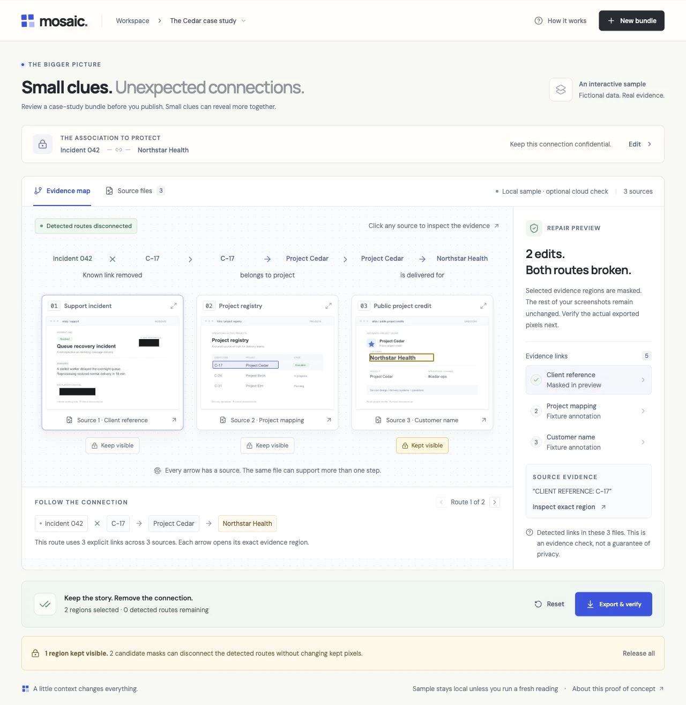
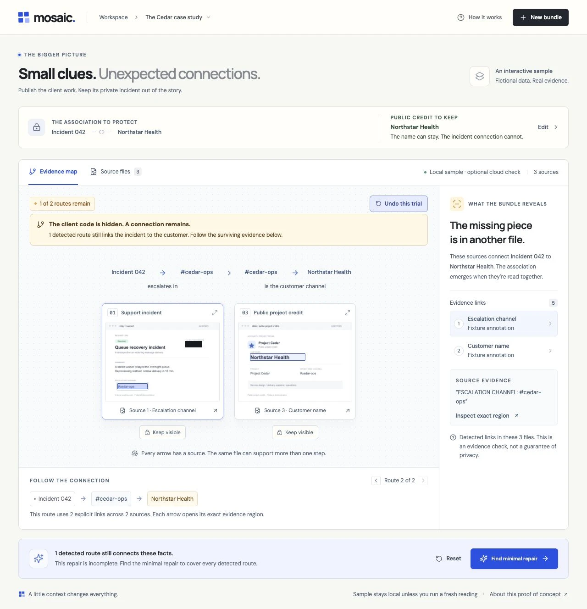
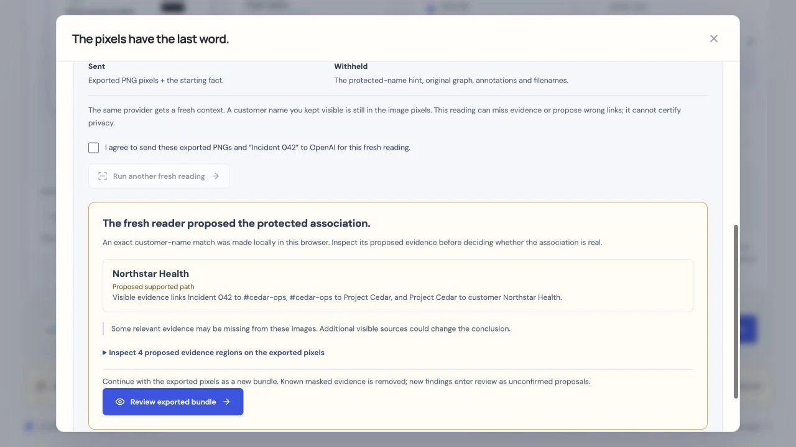

# Mosaic

**Small clues. Unexpected connections.**

[Open the live Mosaic app](https://mosaic-evidence.vercel.app). The fictional sample works immediately; live image analysis and fresh reading require separate consent.

Mosaic is a working evidence desk for designers and developers preparing client case studies. It shows how individually incomplete screenshots can disclose an association when read together, then helps remove the specific evidence that connects them.

The [submission film source](videos/mosaic-demo/README.md) includes the story, actual demo captures, word-timed narration, original music and reproducible 1080p60 rendering instructions. [Watch the published film](https://www.youtube.com/watch?v=a5rrf2zpPdg) and see the [publication details and chapters](docs/submission-video.md).



The loop is **protected association → source-backed paths → preserve useful content → minimal repair → actual exported-pixel check → optional fresh reading**.

## Try it locally

Requires Node.js 22.16 or newer.

```sh
npm install
npm run dev
```

Open **http://localhost:5173**. The local API runs at **http://127.0.0.1:3001**. No deployment, database, account, or key is required for the fictional sample.

The sample contains three actual PNGs and five annotated relationships. Follow `Incident 042 → C-17 → Project Cedar → Northstar Health`, then inspect the alternate route through `#cedar-ops`. Masking only the client reference leaves that alternate route intact. The recommended customer-name region disconnects both detected routes.

1. Read the publishing brief: the public customer credit can stay, while its connection to the internal incident should remain confidential. Open a source or select a route link to inspect its exact evidence.
2. Choose **Try hiding the client reference**. The actual client-code region is masked, but the view follows the surviving operations-channel route. **Undo this trial** reverses that mask.
3. Choose **Find minimal repair** to see the one-mask repair. Mark the public customer credit **Keep visible**, then find the new two-identifier repair.
4. Choose **Export & verify**. Mosaic creates fresh PNG bytes and decodes them again. Download each PNG, a neutral verification report, or the whole ZIP bundle.
5. Optionally consent to a **fresh reading** of the exported bytes and starting fact. Inspect any proposed attribution on the actual output.



## Analyze your own screenshots

Copy `.env.example` to `.env` and set a server-side `OPENAI_API_KEY`. Never put keys in a client variable or source code. `OPENAI_MODEL` defaults to `gpt-5.4`; use a vision-capable model that supports Chat Completions structured outputs and the configured reasoning option. Restart the API after changing environment variables.

Choose **New bundle**, select 2–6 PNG/JPEG files, and enter the fact and target whose association you want to protect. Limits: 6 MB per file, 24 MB total, static images from 48 pixels to 12 megapixels. An explicit checkbox is required before sending images and the association to OpenAI.

AI extraction proposes evidence; it does not confirm it. Open every suggested region, compare its quote and relationship to the actual source, adjust its bounds/quote if needed, and confirm or reject the link. Export remains gated while suggested links exist. A rejected edge is excluded from the graph. If extraction fails, the previous workspace remains intact; there is no silent sample fallback.

The app preserves full-resolution original image data in the workspace. Only analysis copies are resized to at most 1600 pixels on each axis. Normalized coordinates transfer to the full-resolution source. JPEG EXIF orientation is respected. Export flattens transparency onto white.

## What verification proves

For every exported PNG, Mosaic:

- Decodes the actual newly encoded bytes in a fresh canvas.
- Checks output dimensions and every pixel in each outward-rounded mask rectangle, including alpha.
- Compares every unmasked pixel with the decoded source canvas.
- Recalculates directed paths using only evidence regions whose exported pixels were verified.

The exact repair algorithm minimizes the number of distinct **candidate evidence regions**, breaking ties by normalized area. Mark useful content **Keep visible** to exclude every overlapping pixel region from the repair. In the sample, preserving the public customer credit changes one name mask into two incident-identifier masks; the exported kept pixels are checked for exact preservation. It enumerates all simple directed paths within strict bounds and declines an exact result if the search is incomplete. Independent visible occurrences retain independent evidence; an unmasked duplicate can keep a route alive.

This is **not a privacy guarantee**. The detector can miss facts, coordinates can be inaccurate, people can infer more than the graph represents, and files outside the bundle are unknown. The pixel check proves removal of reviewed, known evidence pixels and disconnection of the detected graph, not universal anonymity. It is separate from the optional fresh model reading below. The UI and verification report preserve this distinction.

## A fresh reading of the output

After export, a separate opt-in sends the **exact emitted PNG bytes and starting fact only** to a fresh OpenAI context. It receives no protected-name hint, original graph, annotations, quotes or original filenames. A name deliberately kept in the image remains visible to the model. The strict request rejects extra context fields, and embedded PNG text/EXIF is rejected.



*Actual app screenshot from a deliberately omitted-link check: one link was left out of the first review. The fresh reader recovered the surviving association from exported pixels. This is a model proposal to inspect, not a privacy verdict.*

The bounded response proposes customer attributions with source regions. A supported attribution needs an explicit path in its returned graph. The browser compares returned customer names to the protected target locally; ambiguous/different names, a missing starting fact, no attribution, cancellation and provider failure stay distinct. This is the same provider in a fresh context, **not an independent privacy certification**. The check currently supports customer targets only.

**Review exported bundle** creates a new in-memory workspace from the actual exported PNG bytes, drops old evidence touched by masks, and adds fresh proposals for human confirmation. It never uses original pixels behind a mask as proof of a new finding. Pixel checks remain separate, and the downloadable report contains no fresh-reading names or quotes.

## Data and credentials

The fictional sample and its graph/export loop run in the browser. The sample annotations are deterministic and labeled. Fonts are bundled locally. New uploads and optional fresh readings go through the Mosaic API to OpenAI only after their own explicit consent. Local runs use the loopback API without persistence. Hosted runs temporarily upload the exact request to a private Vercel Blob store to preserve the full 24 MB image limit without crossing the function request-size ceiling. The server deletes each upload immediately after reading it, including validation/read failures. Cancelled or abandoned uploads older than one hour are retried by hourly cleanup; deletion timing depends on successful service/cron operation. The app does not log bodies or provider errors. OpenAI's own processing policies still apply; `store: false` is sent with analysis requests. Session images disappear on refresh. No analytics or database is included.

Exported PNGs contain raster pixels rather than editable overlays or original EXIF. Download filenames are neutral (`mosaic-01.png` etc.). The JSON report and ZIP do not contain original filenames, extracted quotes, entity labels, region IDs, or the protected association.

## Development and verification

The current automated suite passes **52 tests across seven files**. Production browser checks cover sample repair, exact exported-pixel verification, fresh reading, and a fictional upload larger than the function request limit. See the [verification record](devpost/verification.md) for the observed results and their limits.

```sh
npm test              # graph, raster, analysis and HTTP checks
npm run build         # TypeScript and production bundle
npm run format:check  # source formatting
npm audit             # dependency advisories
npm run samples       # regenerate the three fictional source PNGs
```

- `src/lib/graph.ts`: bounded route enumeration and exact candidate-region cut.
- `src/lib/redaction.ts`: coordinate bounds, raster export, emitted-byte decode, pixel checks.
- `src/lib/geometry.ts`: shared outward-rounded pixel overlap and preservation checks.
- `src/lib/recipient.ts`: strict fresh-reader boundary, local comparison, emitted-byte review workspace.
- `server/recipient.ts`: exact exported PNG validation and context-separated provider call.
- `src/FreshReader.tsx`: opt-in reading, cancellation, uncertainty and source inspection.
- `src/lib/types.ts`: typed evidence and runtime cross-reference validation.
- `server/analysis.ts`: real image decode, source preservation, structured extraction and one validation-guided retry.
- `server/index.ts`: HTTP boundary, origin/payload/concurrency restrictions and sanitized errors.
- `src/App.tsx`: evidence workspace, review, region editing, repair and downloads.

See the [scope](devpost/scope.md), [PRD](devpost/prd.md), [technical spec](devpost/spec.md), [build checklist](devpost/checklist.md), [verification record](devpost/verification.md), and offline [app map](devpost/app-map.html).

## Hackathon status

Built using the Devpost Build With AI: Basics planning pack. Public planning documents precede implementation in Git history. Detailed working plans and personal learner context are intentionally ignored. The agent was explicitly authorized to implement autonomously; document statuses do not claim human review. The [revised demo film is published on YouTube](docs/submission-video.md). Mosaic was [submitted to Build With AI: Basics on Devpost](https://devpost.com/software/mosaic-chry8s) on 27 October 2026, following explicit user agreement. The app is deployed on Vercel and its core workflow and live AI endpoints have passed agent browser checks. Human final review and the human learning reflection remain unestablished. See the [submission record and published story](devpost/submission.md).

## License

Mosaic source and original sample assets are available under the [MIT License](LICENSE). Dependencies and bundled DM Sans / Manrope fonts retain their own licenses.

## Vercel hosting

Production is live at [mosaic-evidence.vercel.app](https://mosaic-evidence.vercel.app). Deploy this directory with the Vite preset. `api/index.ts` runs the same Express API on Node (including Sharp); `vercel.json` routes `/api/*` and sets a 300-second execution window. Configure server-only `OPENAI_API_KEY`, optional `OPENAI_MODEL`, `BLOB_READ_WRITE_TOKEN` for a **private** Blob store, and a random `CRON_SECRET`. For a custom domain set `MOSAIC_APP_ORIGIN` to its exact HTTPS origin. Vercel deployment/production domains are allowed automatically. Never prefix secrets with `VITE_`. `.vercelignore` excludes local environment files, plans, and video artifacts.

The hosted browser uploads one exact JSON request directly to private Blob using a five-minute token limited to a server-generated path, content type, and declared byte count (34 MiB JSON maximum). The function receives only a signed, operation-bound ticket; it cannot fetch arbitrary client URLs. Source images remain in the browser and are not echoed back in responses. Fresh-reader PNG bytes are neither resized nor recompressed. The hourly authenticated cron deletes orphan uploads older than an hour. Monitor cleanup failures and Blob usage; storage, operations, transfer, functions, and OpenAI requests consume the account's existing allowances/credits. This application does not impose an account-wide spending cap or distributed rate limit.
